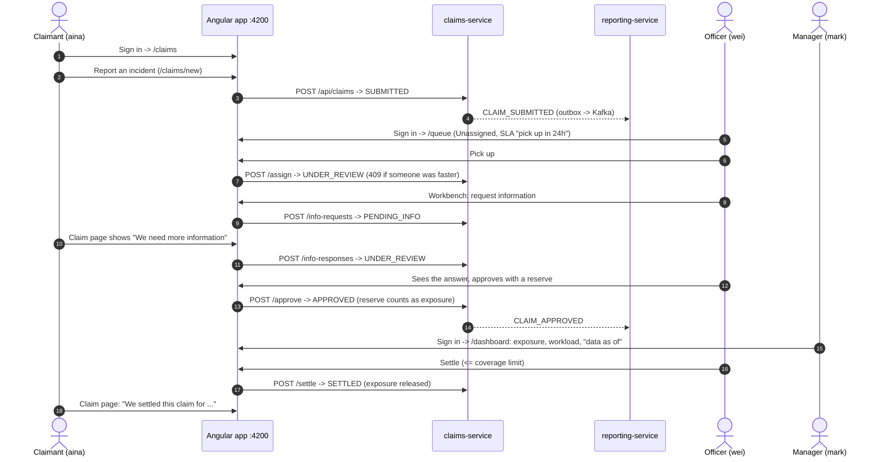

# One app, two kinds of user

Claimants and claims staff use the **same Angular application** (http://localhost:4200). Signing in returns a JWT whose
role decides where the router sends you and which screens the guards allow; the backend enforces the same rules
independently. The two sides never talk directly: every hand-off is a change of claim state through the API, which
the other person sees on their next poll (10 s for claimants, 15 s for officers).

| Need from the brief | Who | Screen | Status / API |
|---|---|---|---|
| Report an incident | Claimant | `/claims/new` | `POST /api/claims` -> `SUBMITTED` |
| Track their claim | Claimant | `/claims`, `/claims/:id` (steps + timeline) | `GET /api/claims[/id]` |
| Provide additional information when asked | Claimant | answer box on `/claims/:id` | `PENDING_INFO` -> `UNDER_REVIEW` |
| Receive decisions | Claimant | decision card on `/claims/:id` | `APPROVED`, `SETTLED`, `REJECTED` (with reason) |
| Pick up incoming claims | Officer | `/queue` Unassigned, oldest first or longest waiting | `POST /assign` |
| Review and assess | Officer | `/workbench/:id`, request info, adjust reserve | `UNDER_REVIEW` ⇄ `PENDING_INFO` |
| Progress to settlement or rejection | Officer | workbench actions valid for the current state | `approve`, `settle`, `reject` |
| See the team's workload and performance | Officer / Manager | queue SLA summary; `/dashboard` workload per officer | `/api/staff/claims/summary`, `/api/reports/workload` |

**Performance today** means SLA state per claim (on track / due soon / overdue against a per-status target) and
workload per officer. Not built yet: historical throughput (claims closed per week) and average time per stage, which
the event history already supports.
